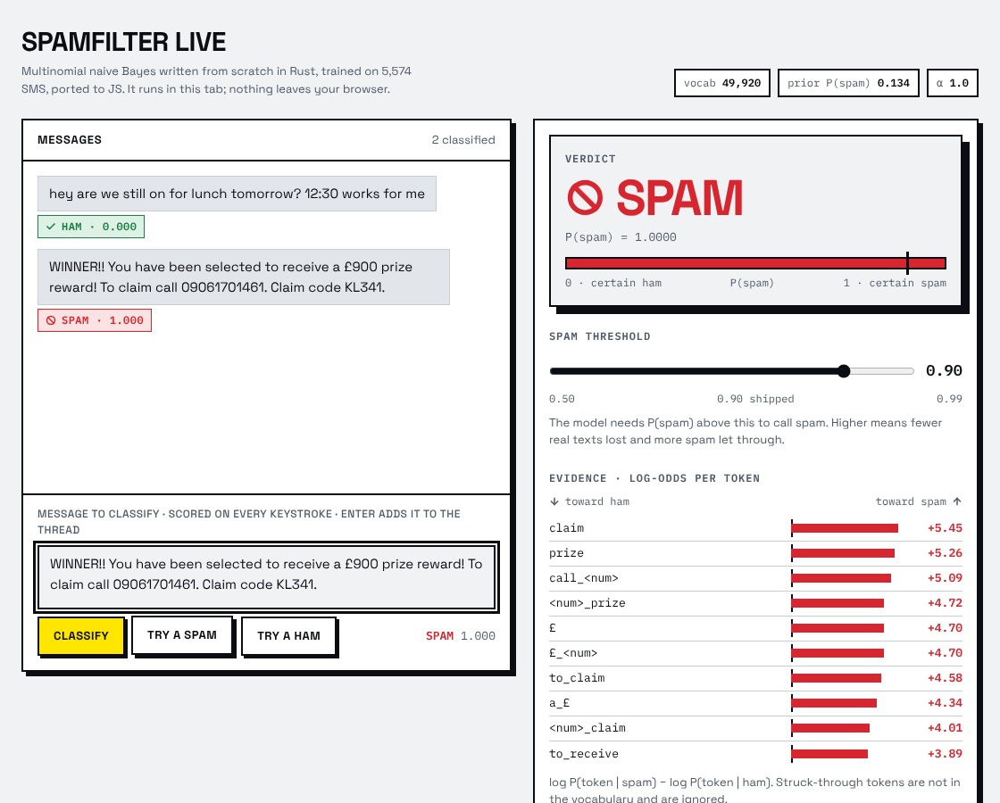

# spamfilter

An SMS spam classifier built from scratch in Rust: multinomial naive Bayes, a
tokenizer tuned for text messages, a majority-class baseline, proper evaluation
on a held-out split, a comparison against the `linfa` library implementation,
and deployment as both a CLI and an Axum HTTP API with a small test page.

**Live demo:** https://evannwilsonn.github.io/spamfilter/ (the trained model, embedded in a single HTML page and ported to JavaScript; scores on every keystroke, nothing leaves the browser).



On a stratified 80/20 split, averaged over ten random seeds, the shipped
configuration (unigrams + bigrams, spam threshold 0.9) reaches **F1 0.955,
precision 0.98, recall 0.93** on the spam class. The majority baseline is 86.6%
accurate and catches zero spam.

## Why naive Bayes

It is the classic text classifier and the right thing to implement by hand once:
training is counting, prediction is adding logs, and every design decision
(smoothing, tokenization, the decision threshold) is visible in about 150 lines
of `src/nb.rs`. It also happens to be strong on short-message spam.

## The loop

The project follows the seven-step loop from the @livmanish AI/ML roadmap:
Problem → Data → Baseline → Model → Evaluation → Improvement → Deployment.

### 1. Problem

Given one SMS, decide whether it is spam. Spam is the positive class. False
positives (a real message filed as spam) are worse than false negatives, so the
decision threshold is a first-class setting rather than hard-coded 0.5.

### 2. Data

[SMS Spam Collection v.1](https://archive.ics.uci.edu/dataset/228/sms+spam+collection)
from the UCI Machine Learning Repository: 5,574 English messages, 4,827 ham
(86.6%) and 747 spam (13.4%). Tab separated, `label<TAB>text`. The parser skips
and counts malformed lines instead of dropping them silently (`src/data.rs`).

The split is **stratified**: each class is shuffled and split separately so the
test set has the same 13.4% spam rate as the corpus. With this little spam, a
plain random split can leave a test set with noticeably fewer positives and make
recall jumpy. Seed is a CLI flag so every number here is reproducible.

### 3. Baseline

Predict the majority class, always ham. Accuracy 0.866, precision/recall/F1
0.0. This is the bar the model has to clear, and it is why accuracy alone is a
misleading metric for this dataset.

### 4. Model

`src/tokenize.rs` lowercases, splits on non-letters, keeps `£ $ € !` as their
own tokens, and collapses every run of digits into one `<num>` token. Phone
numbers and prize amounts never repeat exactly, so the raw digits are useless;
the fact that a number is present is the signal.

`src/nb.rs` is multinomial naive Bayes with add-α (Laplace) smoothing:

```
P(spam | tokens) ∝ P(spam) · Π P(token | spam)
P(token | c)     = (count(token, c) + α) / (tokens_in_c + α · |V|)
```

Prediction sums log-probabilities (a 40-token message would underflow if the
probabilities were multiplied) and normalises with log-sum-exp so `p_spam` is a
real probability. Out-of-vocabulary tokens are skipped at predict time; see
Improvement for why that matters. Each prediction also returns the five tokens
with the largest log-odds contribution so the CLI and the API can show *why*.

### 5. Evaluation

`spamfilter eval` trains on the training split and reports accuracy, precision,
recall, F1 and the confusion matrix for every variant. `--linfa` adds the
`linfa-bayes` `MultinomialNb` trained on the same tokens as a check on the maths.

Seed 42 (train 4,460 / test 1,114, 149 spam in test):

| model                                  | acc    | prec   | recall | f1     | tp  | fp | fn | tn  |
|----------------------------------------|--------|--------|--------|--------|-----|----|----|-----|
| majority baseline (always ham)         | 0.8662 | 0.0000 | 0.0000 | 0.0000 | 0   | 0  | 149| 965 |
| naive bayes, unigrams                  | 0.9874 | 0.9530 | 0.9530 | 0.9530 | 142 | 7  | 7  | 958 |
| naive bayes, unigrams+bigrams          | 0.9883 | 0.9658 | 0.9463 | 0.9559 | 141 | 5  | 8  | 960 |
| naive bayes, bigrams, threshold 0.9    | 0.9910 | 0.9860 | 0.9463 | 0.9658 | 141 | 2  | 8  | 963 |
| naive bayes, bigrams, threshold 0.99   | 0.9910 | 0.9929 | 0.9396 | 0.9655 | 140 | 1  | 9  | 964 |
| linfa MultinomialNb, unigrams          | 0.9874 | 0.9530 | 0.9530 | 0.9530 | 142 | 7  | 7  | 958 |
| linfa MultinomialNb, unigrams+bigrams  | 0.9883 | 0.9658 | 0.9463 | 0.9559 | 141 | 5  | 8  | 960 |

The from-scratch model and `linfa` agree to the confusion cell on both feature
sets, which is the point of the comparison.

One seed is one draw. Over ten seeds (1–5, 7, 11, 13, 17, 42):

| model                                | f1 mean | f1 sd  | precision | recall |
|--------------------------------------|---------|--------|-----------|--------|
| naive bayes, unigrams                | 0.945   | 0.014  | 0.948     | 0.942  |
| naive bayes, unigrams+bigrams        | 0.952   | 0.016  | 0.966     | 0.938  |
| naive bayes, bigrams, threshold 0.9  | 0.955   | 0.014  | 0.981     | 0.931  |
| naive bayes, bigrams, threshold 0.99 | 0.956   | 0.015  | 0.992     | 0.923  |

### 6. Improvement

Three changes, each measured:

1. **Skipping out-of-vocabulary tokens at predict time.** The first version
   scored unseen tokens with the smoothed probability α / (N_c + α·|V|). That
   number is larger for whichever class has fewer total tokens (spam), so every
   unknown word tilted the verdict toward spam. On seed 42 this was 13 false
   positives instead of 7, and it is why the first run disagreed with `linfa`.
   Dropping them is what scikit-learn's vectorizer does too.
2. **Bigrams.** Appending adjacent word pairs ("call now", "txt stop") lifts F1
   by about 0.7 points on average and precision by about 2 points, at a small
   cost in recall. Vocabulary grows from ~8k to ~50k tokens; the saved model is
   under 1 MB.
3. **Decision threshold.** Raising it from 0.5 to 0.9 roughly halves false
   positives (mean precision 0.966 → 0.981) for a ~0.7-point recall drop. 0.99
   pushes precision to 0.992 but recall below 0.93. The shipped model uses 0.9.

The gains are real but modest, and all within about one standard deviation of
each other across seeds. Naive Bayes with unigrams is already most of the way
there on this dataset.

What was tried and did not help: nothing else yet. Obvious next steps are
TF-IDF weighting, a logistic regression comparison, and a character n-gram
tokenizer for obfuscated spam ("fr33", "w1n").

### 7. Deployment

Two surfaces, both backed by the same `model.json`:

- **CLI**: `spamfilter predict "..."` prints the label, `p_spam`, and the top
  evidence tokens.
- **Browser demo** (`docs/index.html`, served by GitHub Pages): the same `model.json` embedded in the page with the naive Bayes maths ported to JavaScript. Checked against the Rust CLI on sample messages, exact match to four decimals.
- **HTTP API** (`src/serve.rs`, Axum): `POST /predict` with `{"text": "..."}`
  returns `{label, p_spam, top_evidence}`; `GET /health` reports vocab size and
  threshold; `GET /` serves a one-file test page. Empty text is a 400, text over
  4 KB is a 413.

A `Dockerfile` builds a small image that trains at build time and serves on
port 3000.

## Usage

```sh
# tests (16 unit tests across data, tokenizer, model, metrics)
cargo test

# evaluate every variant on a held-out split, with the linfa comparison
cargo run --release -- eval --linfa
cargo run --release -- eval --seed 7 --json

# train the shipped configuration on the full corpus
cargo run --release -- train --bigrams --threshold 0.9

# classify one message
cargo run --release -- predict "WINNER!! Claim your £900 prize, call 09061701461"

# serve
cargo run --release -- serve          # http://127.0.0.1:3000
curl -X POST localhost:3000/predict -H 'content-type: application/json' \
     -d '{"text":"are we still on for lunch?"}'
```

`linfa-bayes` 0.8.1 leaves a `dbg!` in its fit path, so `eval --linfa` prints
the whole model to stderr. Redirect stderr if that is in the way.

## Layout

```
src/
  data.rs       load the TSV, stratified split
  tokenize.rs   SMS tokenizer, optional bigrams
  nb.rs         multinomial naive Bayes from scratch, with explanations
  metrics.rs    confusion matrix, precision/recall/F1, majority baseline
  linfa_cmp.rs  same features through linfa-bayes, for comparison
  serve.rs      Axum router
  main.rs       CLI: eval | train | predict | serve
static/index.html   test page served at /
docs/index.html     standalone browser demo (GitHub Pages)
data/SMSSpamCollection.tsv
```

## Attribution

Dataset: Almeida, T.A., Gómez Hidalgo, J.M., Yamakami, A. "Contributions to the
Study of SMS Spam Filtering: New Collection and Results." Proceedings of the
2011 ACM Symposium on Document Engineering. Distributed via the UCI Machine
Learning Repository under CC BY 4.0.

The project loop (Problem → Data → Baseline → Model → Evaluation → Improvement
→ Deployment) and the choice of project come from the @livmanish AI/ML roadmap.
All code is original.

## License

MIT. See `LICENSE`.
